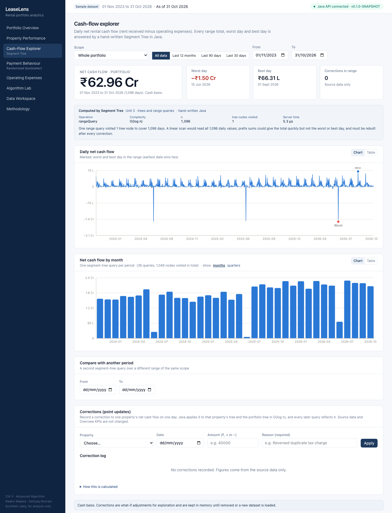
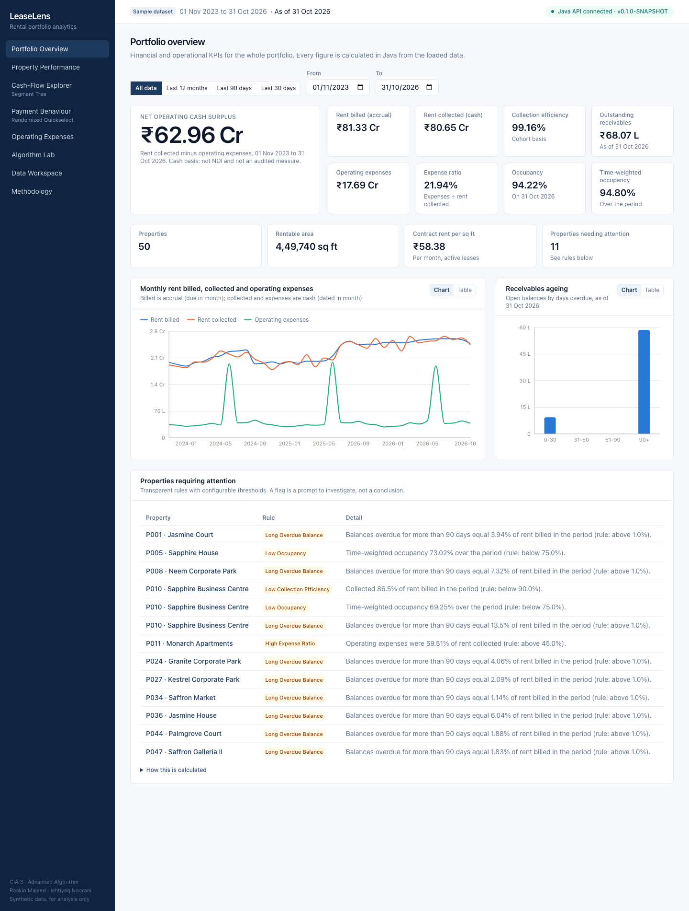
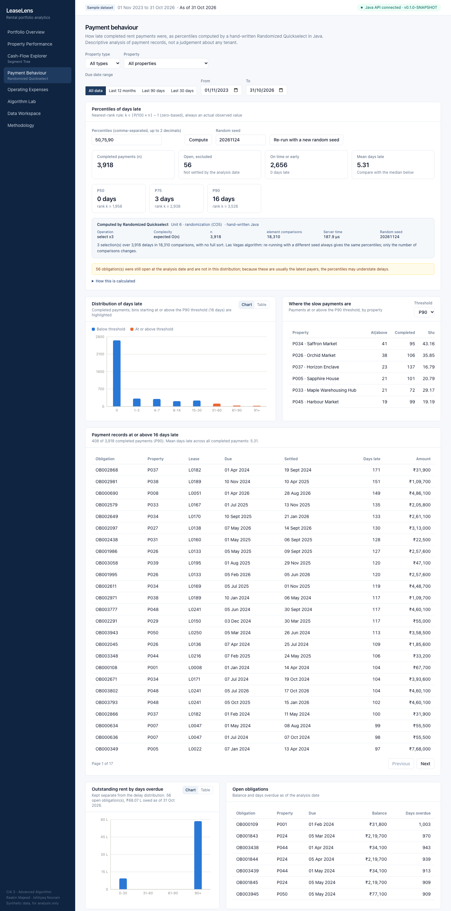
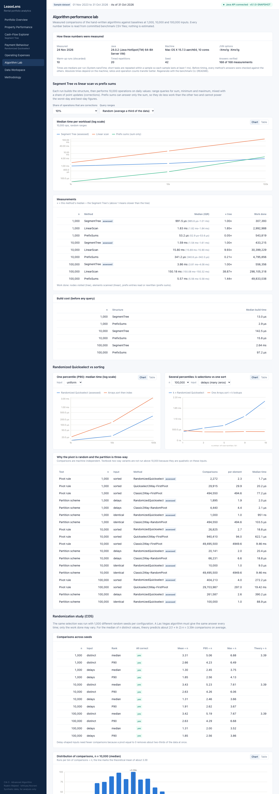
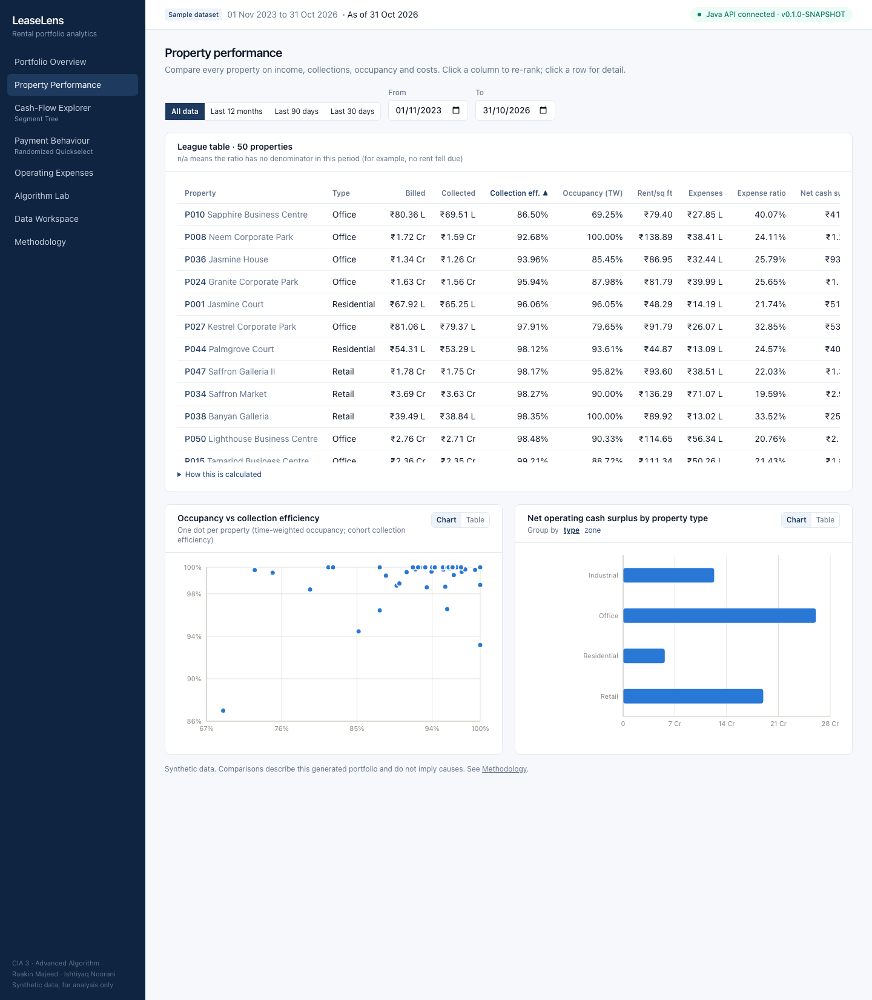

# LeaseLens

**Rental portfolio cash-flow and payment-behaviour analytics**, built on two hand-written algorithms in Java:
- a **Segment Tree** (syllabus Unit 3) for range sum, min and max of daily net cash flow, with O(log n) corrections;
- **Randomized Quickselect** (syllabus Unit 6, CO5) for payment-delay percentiles in expected O(n).

CIA 3 Advanced Algorithm project, ATLAS uGDX, 2026–27. **Raakin Majeed (2404537) · Ishtiyaq Noorani (2408912)**



## Quick start
| Tool | Version | Check |
|---|---|---|
| JDK | 21 or newer | `java -version` |
| Node.js | 20.19+ or 22.12+ (developed on 24) | `node -v` |
| Maven | not needed: the wrapper `./mvnw` downloads it | n/a |
| Python (optional, EDA only) | 3.11+ | `python3 --version` |

Build and run all 172 tests (Windows: `mvnw.cmd verify`):
```bash
./mvnw verify
```
Terminal 1: Java API on http://localhost:8090 (the sample dataset loads automatically):
```bash
./mvnw -DskipTests package && java -jar leaselens-api/target/leaselens-api.jar
```
Terminal 2: frontend on http://localhost:5173 (forwards `/api` to the backend):
```bash
cd frontend && npm ci && npm run dev
```
Open **http://localhost:5173**.

### Environment variables (optional, no secrets)
| Variable | Default | Purpose |
|---|---|---|
| `PORT` | `8090` | Backend port |
| `LEASELENS_API_URL` | `http://localhost:8090` | Backend URL used by the Vite dev proxy |
| `LEASELENS_AUTOLOADSAMPLE` | `true` | Load the bundled sample at start-up |

## What the app does
| Screen | What it shows | Engine (Java) |
|---|---|---|
| Portfolio Overview | 12 KPIs (cash vs accrual labelled), monthly trend, receivables ageing, rule-based attention list | KPI services |
| Property Performance | Sortable league table, occupancy vs collection scatter, type/zone segments, property detail | KPI services |
| **Cash-Flow Explorer** | Net cash flow, worst and best day for any range and scope; month/quarter periods; A/B comparison; **corrections as point updates** with before/after, undo and reset | **Segment Tree** |
| **Payment Behaviour** | P50/P75/P90 and custom percentiles of days late; **new-seed demo** (same answer, different work); threshold histogram; slow records; outstanding ageing | **Randomized Quickselect** |
| Operating Expenses | Category, monthly and per-property spend; unusual records (Tukey fences, quartiles by Quickselect) | Quickselect |
| Algorithm Lab | Measured benchmarks vs baselines at 1k / 10k / 100k, the CO5 seed study, and a bounded live run | Benchmark harness |
| Data Workspace | Load the sample or golden dataset, upload CSVs with a full validation report, set the analysis date | 20-rule validator |

Every algorithm-backed result shows an **Algorithm panel**: method, syllabus unit, complexity, n, nodes visited or comparisons, server time and seed.

## API examples
```bash
curl http://localhost:8090/api/portfolio/overview
curl "http://localhost:8090/api/properties/performance?sort=collectionEfficiencyPct&order=asc"
curl "http://localhost:8090/api/cashflow/range?scope=portfolio&from=2025-04-01&to=2026-03-31"
curl "http://localhost:8090/api/payments/percentiles?p=50,75,90&propertyType=RETAIL&seed=1"
curl -X POST http://localhost:8090/api/cashflow/adjustments -H "Content-Type: application/json" -d '{"propertyId":"P012","date":"2025-07-14","amountPaise":150000,"reason":"Reversed duplicate utility charge"}'
curl -X POST "http://localhost:8090/api/datasets/sample?name=golden"
curl -F files=@properties.csv -F files=@tenants.csv -F files=@leases.csv -F files=@rent_obligations.csv -F files=@rent_transactions.csv -F files=@expenses.csv http://localhost:8090/api/datasets/upload
```
Errors use RFC 7807 `application/problem+json` (400 invalid input, 404 unknown id, 409 no dataset or busy, 422 rejected upload). Full contract: [docs/api/API_CONTRACT.md](docs/api/API_CONTRACT.md).

## Data (synthetic, reproducible)
| Folder | Contents |
|---|---|
| `data/sample/` | Default portfolio (seed 20261124): 50 properties, 251 leases, 3,974 rent obligations, 4,238 payments, 9,688 expenses, 1,096 days |
| `data/golden/` | Two properties with every answer worked out by hand in `EXPECTED.md` |
| `data/invalid/` | 23 datasets, each with one deliberate defect, for the error-handling demo |
| `data/GENERATOR_SPEC.md` | Generator assumptions, planted patterns and limitations |

No real people, properties or financial records are used. Regenerate the data (the output is byte-identical):
```bash
./mvnw -q -DskipTests package
java -jar leaselens-generator/target/leaselens-generator.jar sample
java -jar leaselens-generator/target/leaselens-generator.jar fixtures
```

## Benchmarks
```bash
java -Xms1g -Xmx1g -jar leaselens-bench/target/leaselens-bench-cli.jar --suite all --sizes 1000,10000,100000 --reps 20 --warmup 10 --seed 42 --seeds 1000
```
This takes about 30 s and writes `benchmarks/results/*.csv`. Method, results and honest findings: [benchmarks/BENCHMARKS.md](benchmarks/BENCHMARKS.md).

## Python EDA (supplementary)
See [analytics/README.md](analytics/README.md). The notebook is committed with its outputs. It re-checks 18 Java figures (all match), and recovers 5 of the 6 planted patterns fully and 1 partly.

## Repository layout
| Path | Contents |
|---|---|
| `leaselens-algorithms/` | **Assessed algorithms**: JDK only, no third-party dependencies |
| `leaselens-data/` | Domain model, CSV parser, validation rules, dataset loader |
| `leaselens-api/` | Spring Boot REST API, services, store |
| `leaselens-generator/` | Seeded synthetic data generator and invalid-fixture builder |
| `leaselens-bench/` | Benchmark harness, baselines and suites |
| `frontend/` | React + Vite + Tailwind + Recharts |
| `analytics/` | Python EDA notebook and figures |
| `benchmarks/` | Committed benchmark results and BENCHMARKS.md |
| `data/` | Sample, golden and invalid datasets |
| `docs/` | Proposal, report, API contract, algorithm notes, demo, QA, viva, screenshots |

## Submission documents
| Document | File |
|---|---|
| A. Proposal | [docs/proposal/LeaseLens_Proposal.pdf](docs/proposal/LeaseLens_Proposal.pdf) |
| C. Technical report | [docs/report/LeaseLens_Technical_Report.pdf](docs/report/LeaseLens_Technical_Report.pdf) |
| D. Demo evidence | [docs/screenshots/](docs/screenshots/), [docs/demo/QA_REPORT.md](docs/demo/QA_REPORT.md), [docs/demo/DEMO_SCRIPT.md](docs/demo/DEMO_SCRIPT.md) |
| Algorithm notes | [docs/algorithms/SEGMENT_TREE.md](docs/algorithms/SEGMENT_TREE.md), [docs/algorithms/RANDOMIZED_QUICKSELECT.md](docs/algorithms/RANDOMIZED_QUICKSELECT.md) |
| Viva preparation | [docs/viva/](docs/viva/) |
| Checklist | [docs/SUBMISSION_CHECKLIST.md](docs/SUBMISSION_CHECKLIST.md) |
| Project records | [PROJECT_PLAN.md](PROJECT_PLAN.md) · [REQUIREMENTS_TRACEABILITY.md](REQUIREMENTS_TRACEABILITY.md) · [DECISIONS.md](DECISIONS.md) · [PROGRESS.md](PROGRESS.md) · [CONTRIBUTIONS.md](CONTRIBUTIONS.md) |

Rebuild the PDFs after editing the Markdown sources (needs Google Chrome and the analytics venv):
```bash
analytics/.venv/bin/pip install markdown pypdf
analytics/.venv/bin/python docs/report/make_figures.py
analytics/.venv/bin/python docs/report/build_pdf.py
```

## Screenshots
| | |
|---|---|
|  |  |
|  |  |

## Troubleshooting
- **Port 8090 is in use:** start the API with `PORT=8091`, then run the frontend with `LEASELENS_API_URL=http://localhost:8091`.
- **`npm ci` fails with EACCES:** the npm cache has root-owned files. Run `sudo chown -R $(id -u):$(id -g) ~/.npm`.
- **UI shows "Java API unreachable":** start the backend first (Terminal 1).
