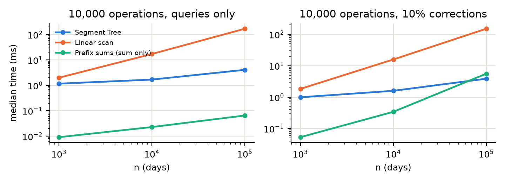
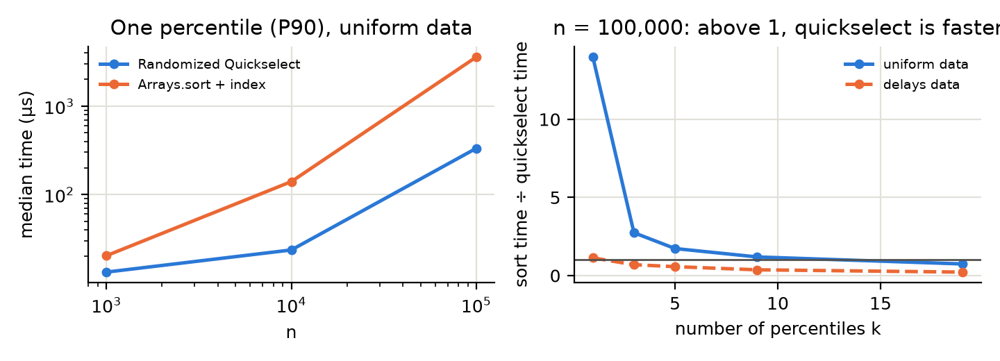

# LeaseLens: Rental Portfolio Cash-Flow and Payment-Behaviour Analytics using Segment Trees and Randomized Selection

<p class="muted">CIA 3 · Advanced Algorithm · B.Tech CS (AI &amp; ML), Semester V · 2026–27 · <b>Raakin Majeed (2404537)</b> · <b>Ishtiyaq Noorani (2408912)</b></p>

## 1. Problem, users and constraints
An operator of a mixed residential and commercial rental portfolio bills rent every month, collects it late, partly or not at all, and pays operating costs daily. Billing, collections and costs sit in separate ledgers, so routine management questions are slow to answer:
- What net cash did a property, or the portfolio, generate between two dates, and what were its worst and best days?
- How late do payments typically arrive, and which payments are in the slow tail?
- Which assets convert billed rent into cash least efficiently?

**LeaseLens** validates and joins the ledgers, answers range questions over daily net cash flow with a hand-written **Segment Tree**, and computes payment-delay percentiles with a hand-written **Randomized Quickselect**. The results are presented as formula-documented KPIs. **Users:** portfolio and asset managers, commercial operators, real-estate analysts. It is decision support, not tenant administration, and it never scores individual tenants.

**Inputs and constraints.** There are six CSV ledgers: properties, tenants (anonymous id and segment only), leases, rent obligations, rent transactions and expenses.
- Amounts are INR held as integer **paise** (no floating point), and dates are ISO.
- Every figure is evaluated **as of an analysis date**: later payments are ignored and ranges cannot pass it.
- A dataset with any validation error is rejected whole. Missing values are never treated as zero.

**Measurable success criteria (all met):**
1. Segment Tree = brute force on 100% of ≥ 10,000 random query/update cases.
2. Quickselect = sorted reference on 100% of cases over ≥ 1,000 seeds and 6 input shapes.
3. KPIs on a hand-computed dataset match to the paisa.
4. Every planted defect is detected with a clear message.
5. Benchmarks at 1k / 10k / 100k against baselines, with crossover conditions reported.
6. A fresh clone builds, tests and runs from the README.

**Relation to the guideline's sample ideas.** The PDF's "inventory risk and percentile dashboard" uses the same algorithm pair. We moved it to a different domain and went substantially beyond it:
- min/max with the earliest date, overflow-checked sums and an auditable correction ledger on the Segment Tree;
- three-way partitioning and exact integer nearest-rank percentiles in Quickselect;
- a 1,000-seed Las Vegas study for CO5;
- workload-aware baselines that report where our methods lose;
- full validation, a golden dataset and planted ground truth.

## 2. System design
<div class="fig" markdown="1">
<svg viewBox="0 0 720 150" width="100%" xmlns="http://www.w3.org/2000/svg" font-family="Helvetica, Arial" font-size="10">
<rect x="5" y="40" width="120" height="70" rx="6" fill="#eef3f9" stroke="#2b4c7e"/><text x="65" y="62" text-anchor="middle" font-weight="bold">React frontend</text><text x="65" y="78" text-anchor="middle">Vite · Tailwind</text><text x="65" y="92" text-anchor="middle">Recharts (display only)</text>
<rect x="160" y="40" width="130" height="70" rx="6" fill="#eef3f9" stroke="#2b4c7e"/><text x="225" y="62" text-anchor="middle" font-weight="bold">leaselens-api</text><text x="225" y="78" text-anchor="middle">Spring Boot REST</text><text x="225" y="92" text-anchor="middle">RFC 7807 errors</text>
<rect x="325" y="10" width="160" height="58" rx="6" fill="#fff" stroke="#2b4c7e"/><text x="405" y="30" text-anchor="middle" font-weight="bold">Services + store</text><text x="405" y="45" text-anchor="middle">KPIs · cash flow · payments</text><text x="405" y="59" text-anchor="middle">snapshot · ledger · 51 trees</text>
<rect x="325" y="82" width="160" height="58" rx="6" fill="#fff" stroke="#2b4c7e"/><text x="405" y="102" text-anchor="middle" font-weight="bold">leaselens-data</text><text x="405" y="117" text-anchor="middle">CSV parser · 20 rules</text><text x="405" y="131" text-anchor="middle">dataset loader</text>
<rect x="520" y="10" width="195" height="58" rx="6" fill="#1e3a5f"/><text x="617" y="30" text-anchor="middle" font-weight="bold" fill="#fff">leaselens-algorithms (JDK only)</text><text x="617" y="46" text-anchor="middle" fill="#fff">SegmentTree (Unit 3)</text><text x="617" y="60" text-anchor="middle" fill="#fff">RandomizedQuickselect (Unit 6)</text>
<rect x="520" y="82" width="195" height="58" rx="6" fill="#fff" stroke="#2b4c7e"/><text x="617" y="102" text-anchor="middle" font-weight="bold">generator · bench · analytics</text><text x="617" y="117" text-anchor="middle">seeded data · benchmarks</text><text x="617" y="131" text-anchor="middle">Python EDA (supplementary)</text>
<line x1="125" y1="75" x2="160" y2="75" stroke="#2b4c7e" stroke-width="1.5"/><text x="142" y="70" text-anchor="middle" font-size="8">JSON</text>
<line x1="290" y1="65" x2="325" y2="45" stroke="#2b4c7e" stroke-width="1.5"/><line x1="290" y1="85" x2="325" y2="105" stroke="#2b4c7e" stroke-width="1.5"/>
<line x1="485" y1="39" x2="520" y2="39" stroke="#2b4c7e" stroke-width="1.5"/><line x1="485" y1="111" x2="520" y2="111" stroke="#2b4c7e" stroke-width="1.5"/>
</svg>

Figure 1. Architecture. The assessed algorithms live in a module with no third-party dependencies. The frontend only displays API results.
</div>

| Endpoint (all under `/api`) | Purpose | Engine |
|---|---|---|
| `POST /datasets/sample`, `POST /datasets/upload`, `PUT /datasets/current/analysis-date` | Load and validate data; set the as-of date | Data loader |
| `GET /portfolio/overview`, `/properties/performance`, `/properties/{id}`, `/properties/segments` | KPIs, attention rules, league table | KPI services |
| `GET /cashflow/range`, `/periods`, `/series`; `POST`/`DELETE /cashflow/adjustments` | Range sum/min/max, period breakdowns, corrections | **Segment Tree** |
| `GET /payments/percentiles`, `/threshold`, `/outstanding` | Delay percentiles, tail records, open balances | **Randomized Quickselect** |
| `GET /expenses/summary`, `/expenses/unusual` | Spend analysis; Tukey fences (quartiles by Quickselect) | Quickselect |
| `GET /benchmarks/results`, `POST /benchmarks/run` | Committed and bounded live benchmarks | Bench harness |

Every algorithm-backed response carries an `algorithm` block: name, syllabus unit, complexity, n, operation count, server time and seed. The UI shows it as an "Algorithm panel", so it is always visible which method produced a figure.

**Data.** There is no public rent-ledger dataset, so a seeded Java generator produces a realistic portfolio: 50 properties, 251 leases, 3,974 obligations, 4,238 payments and 9,688 expenses over 1,096 days. The same seed always gives byte-identical files.
- It plants **five documented patterns and a negative control**: a retail late-payment tail, monsoon maintenance, two vacancy shocks, outsized repairs, one office with degrading collections, and no expense–collection link. This lets the analysis be checked against known truth.
- A hand-computed **golden dataset** and **23 single-defect fixtures** support testing and the error-handling demo.

## 3. Algorithm A: Segment Tree (Unit 3)
**Role.** Value *i* is day *i*'s net cash flow (rent received − operating expenses) for one property. There is one tree per property and one for the portfolio. The tree answers sum, minimum and maximum (with the earliest date of each) over any date range, and applies corrections as point updates to the property tree and the portfolio tree.

```
BUILD(node, lo, hi): if lo = hi: leaf ← v[lo] else BUILD(left), BUILD(right), PULL(node)
PULL(node):  sum ← sum[L] + sum[R] (overflow-checked); min/max ← better child, ties keep the LEFT child
QUERY(node, lo, hi, l, r, acc):
    if r < lo or hi < l: return                          ▷ no overlap
    if l ≤ lo and hi ≤ r: acc ← MERGE(acc, node); return    ▷ canonical node
    QUERY(left …); QUERY(right …)                        ▷ left first, so ties resolve to the earliest day
UPDATE(node, lo, hi, i): descend to leaf i, set it, then PULL every ancestor bottom-up
```
**Correctness.** Invariant (I): every node stores the sum, minimum and maximum of its interval.
- **Build:** by induction on interval length, PULL combines two disjoint child intervals correctly.
- **Query:** it merges only nodes fully inside [l, r] and splits only on partial overlap. The merged nodes are therefore disjoint and cover [l, r] exactly, and left-to-right merging makes the earliest index win ties.
- **Update:** it changes exactly the nodes whose intervals contain *i* (one root-to-leaf path) and restores (I) bottom-up.
- **Overflow:** `Math.addExact` raises an error rather than wrapping silently, and a failed update is rolled back.

**Complexity.** Build O(n). Query O(log n): at most two partially overlapping nodes per level are expanded, so at most 4 nodes are visited per level; a test checks this bound at n = 100,000. Update O(log n). Space O(n): five arrays of 4n entries. For 1,096 days a query visits at most 48 nodes; a full-range query visits 1.

## 4. Algorithm B: Randomized Quickselect (Unit 6, CO5)
**Role.** Percentiles (P50, P75, P90, any P with up to two decimals) of days late for completed payments; the threshold for the slow-payment list; expense quartiles. Nearest rank: k = ⌈P·n/100⌉ − 1, computed in **exact integer arithmetic** with P in hundredths. A test shows floating point would pick the wrong rank for P = 7, n = 100.

```
SELECT(a, k, rng):  lo ← 0; hi ← n − 1
  loop: if lo = hi: return a[lo]
        pivot ← a[lo + rng.uniform(0 .. hi − lo)]
        3-way partition a[lo..hi] into  < pivot | = pivot | > pivot   (lt .. gt is the '=' block)
        if k < lt: hi ← lt − 1  elif k > gt: lo ← gt + 1  else return pivot
```
**Correctness.** The partition loop keeps a < / = / unexamined / > invariant. The outer loop keeps the invariant that the rank-k value lies in a[lo..hi], with smaller values to the left and larger to the right. Each round shrinks the range or returns, because the '=' block holds the pivot. It is a **Las Vegas** algorithm: the answer never depends on the seed; only the running time does.

**Complexity.** Expected O(n): a "good" pivot (middle half) appears with probability ≥ ½ and leaves at most ¾ of the range, so E[comparisons] ≤ 2n·Σ(¾)^j = 8n. The classical sharper analysis gives about 2(1 + ln 2)n ≈ 3.39n for the median. Worst case Θ(n²), with vanishing probability. Space O(n) for the defensive copy, O(1) extra, and the loop is iterative. **Three-way partitioning** matters here: about 68% of delays are 0, and a two-way partition is quadratic on equal keys.

## 5. Correctness evidence
| Module | Tests | Highlights |
|---|---|---|
| Algorithms | 79 (Segment Tree 22, Quickselect 19, Percentile 38) | boundaries, ties, invalid ranges and ranks, overflow with rollback; **randomized differential tests**: 5 × 10,000 mixed tree operations against brute force; quickselect = sort over **1,000 seeds × 6 shapes**; mean comparisons ≈ 3.39n; node-visit bound |
| Data | 40 | parser, golden load, **each of 23 fixtures rejected with its rule**, edge cases, issue cap |
| Generator | 11 | byte-identical per seed; committed sample reproducible; each planted pattern present |
| API | 36 | **every value in the hand-computed EXPECTED.md matches exactly**; all endpoints; 400/404/409/422 errors; as-of logic; uploads |
| Benchmarks | 6 | baselines proven correct before they are trusted |
| **Total** | **172**, all passing from a fresh clone | plus 18 Java figures re-derived independently in pandas (all match) |

## 6. Benchmark methodology and results
Sizes are n = 1,000 / 10,000 / 100,000 with identical seeded inputs for every method. Each task had 10 warm-ups and 20 timed repetitions, with medians and IQR reported. Sub-millisecond tasks are batched so each sample lasts at least 1 ms, and results go to a volatile sink. Before timing, every method's answers were checked against the others: **168 measurements, all verified**. Setup: macOS on Apple silicon (10 cores), JDK 24, 1 GB fixed heap. The tables in `benchmarks/BENCHMARKS.md` are generated from the committed CSVs.

<div class="fig" markdown="1">


Figure 2. 10,000 range operations on daily values. The tree's lead over a scan grows with n. Prefix sums (which cannot give min/max) win when there are no corrections, but fall behind at n = 100,000 with 10% corrections.
</div>

| Experiment | 1,000 | 10,000 | 100,000 |
|---|---|---|---|
| Tree vs linear scan, random ranges, 10% corrections (scan time ÷ tree time) | 1.8× | 9.9× | **38.9×** |
| Prefix sums ÷ tree, 10% corrections / 50% corrections | 0.05 / 0.25 | 0.21 / 1.12 | **1.44 / 7.88** |
| Tree vs scan, short ranges (≤ 32 days) | 0.3× | 0.2× | **0.1×** (scan wins) |
| One P90: sort time ÷ quickselect time, uniform / delay-shaped data | 1.53 / 3.24 | 5.93 / 1.02 | **10.77 / 0.85** |
| Textbook two-way, first-pivot quickselect on sorted input: comparisons | 494,550 | 49,495,500 = n(n−1)/2 | not run (quadratic) |
| Randomized Quickselect on the same input: comparisons | 2,272 | 26,825 | 404,213 |

<div class="fig" markdown="1">


Figure 3. Left: one percentile, expected O(n) against O(n log n). Right: with k percentiles, one sort eventually wins (from k ≈ 19 on uniform data, k = 3 on duplicate-heavy delay data).
</div>

**When each method helps (honest conditions).**
- The tree wins for long ranges needing min/max and for correction-heavy workloads. A scan wins for short ranges. Prefix sums win for sum-only queries with rare corrections. Building the tree costs 4–27× more than a prefix array.
- Quickselect wins for one or a few percentiles of large unordered data. The JDK sort wins on presorted or identical input, and for many percentiles. **LeaseLens computes 3 percentiles on about 3,900 delays, where a single sort would be as fast.** Randomized selection is justified by its expected-linear guarantee, by the threshold and quartile queries, and as the Unit 6 technique, not by speed on this workload.
- **CO5 seed study:** over 1,000 seeds per configuration (12,000 runs), every answer was correct. The mean number of comparisons was 3.31n, 3.43n and 3.42n against the theoretical 3.39n; the 95th percentile was about 5.2n and the maximum 7.7n.

## 7. Analytical results (synthetic portfolio)
On the sample: net operating cash surplus **₹62.96 Cr** (cash basis, not NOI), collection efficiency **99.16%** (cohort basis), occupancy **94.22%**, and 56 open obligations.

The Python EDA (pandas, NumPy, SciPy, Matplotlib) recovered every planted pattern from the data alone, except outsized repairs (partly, 3 of 6):
- retail pays later (Mann–Whitney p = 7×10⁻²², rank-biserial effect 0.19);
- monsoon maintenance is 2.01× other months;
- P005 and P006 were vacant for 8 months;
- P008's collection efficiency fell by 11.9 points.

The negative control held: expense ratio against collection efficiency gave ρ = −0.02, 95% CI [−0.30, 0.28]. A hand-written **Kaplan–Meier** estimate quantified the censoring bias the UI warns about: including open obligations, P90/P95 are 19/37 days against 16/29 for completed payments only. No causal claims are made.

## 8. Limitations
- The data is synthetic, so findings demonstrate the method, not market facts.
- Corrections are held in memory and change only the explorer.
- The delay distribution excludes open obligations, which is disclosed and quantified.
- Benchmarks come from one machine and use a custom harness without JMH fork isolation.
- At the app's data size both algorithms answer in microseconds, so their value lies in their guarantees and scaling, as §6 shows.
- The Unit 6 classification of randomized selection should be confirmed by faculty, since Quickselect also appears in Unit 1.

## 9. Individual contributions
| Member | Owned (wrote, reviewed, explains in viva) | Shared |
|---|---|---|
| **Raakin Majeed (2404537)** | Segment Tree and its tests and proofs; cash-flow service and correction ledger; Cash-Flow Explorer screen; segment-tree benchmarks; validation module and golden dataset | API services, frontend, QA, report |
| **Ishtiyaq Noorani (2408912)** | Randomized Quickselect, nearest-rank percentiles, tests and proofs; payment-behaviour service and screen; quickselect benchmarks and CO5 seed study; data generator; Python EDA | API services, frontend, QA, report |

Git history attributes commits to their owners, with co-author trailers for joint work (`CONTRIBUTIONS.md`). Development was assisted by an AI coding tool (Claude Code). Each member reviewed and tested the code in their area and can walk through every line of their algorithm.

**References.** D. E. Knuth, *The Art of Computer Programming*, Vol. 3 (randomized selection analysis). Cormen, Leiserson, Rivest and Stein, *Introduction to Algorithms*, 3rd ed., Ch. 9 (selection) and Ch. 14 (augmented trees). *CIA 3 Advanced Algorithm Project Guidelines 2026–27*, ATLAS uGDX.
